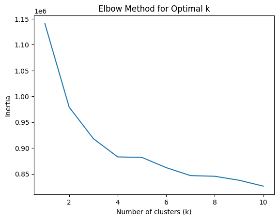
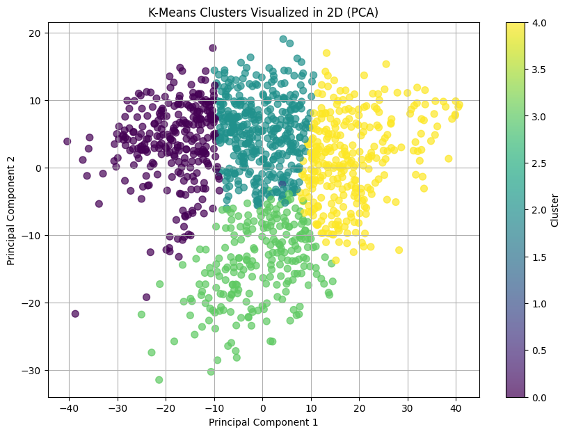

# Netflix Movie Rating Analysis

A recommender-style analysis of a sparse user-by-movie rating matrix. Matrix factorization fills in the missing ratings, and K-Means clustering with PCA then groups movies by how users rate them. Built in Python with NumPy, scikit-learn, and SciPy.

## Key Results

- **Prediction:** The factorization model (3 latent factors) predicted missing ratings with an RMSE of 0.503 on the 1 to 5 scale, evaluated against a complete version of the matrix.
- **Clustering:** K-Means grouped movies into three clusters based on user rating patterns, with k chosen using the elbow method and visualized in two dimensions with PCA.

## Data Source

[Netflix Movie Ratings](https://www.kaggle.com/datasets/luisheitorribeiro/netflix-movie-ratings) — Kaggle

_The dataset contains an incomplete user-by-movie rating matrix along with a complete version used to evaluate the predictions. Ratings range from 1 to 5, with missing ratings represented by 0 in the incomplete matrix._

## Methodology

### 1. Matrix Factorization

Matrix factorization was used to estimate missing ratings in the incomplete rating matrix. The model represents users and movies using latent factors and alternates between estimating user and movie factors.

The model was trained using:

* **Rank:** 3 latent factors
* **Regularization parameter:** 0.001
* **Maximum iterations:** 10

### 2. Movie Clustering

The completed rating matrix was used to represent each movie by its rating pattern across users. The movie vectors were normalized and clustered using K-Means.

The elbow method was used to evaluate different numbers of clusters. The plot showed a noticeable bend around **k = 3**, so three clusters were used for the final analysis.

### 3. PCA Visualization

PCA was used to reduce the movie rating data to two dimensions for visualization. Each point represents a movie, with color indicating its K-Means cluster assignment.

## Findings

### 1. Matrix Factorization Performance

The final model achieved an **RMSE of 0.503** when comparing the predicted ratings with the complete rating matrix. RMSE is measured on the same 1-5 scale as the original ratings, with lower values indicating smaller prediction errors.

### 2. Movie Clusters

K-Means identified three groups of movies based on similarities in their user rating patterns. The cluster assignments provide a way to explore whether movies with similar rating behavior tend to group together.

### 3. PCA Visualization

The PCA plot provides a two-dimensional view of the movie rating patterns and allows the K-Means clusters to be visually compared. Movies that appear closer together have more similar patterns in the dimensions captured by the PCA visualization.

## Tools

Python, NumPy, pandas, SciPy, scikit-learn, Matplotlib, Google Colab
